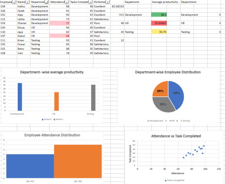

# Case-Study-1---Employee Performance
Employee Performance Analysis
# Problem Statement

An IT company maintains employee attendance and monthly productivity records. The HR department wants to identify employees with poor attendance, compare department-wise productivity, and analyze the relationship between attendance and productivity.

Project Overview

This project analyzes employee performance data using Microsoft Excel. It uses data analysis techniques, conditional formatting, and charts to understand employee productivity, attendance, task completion, and departmental performance.

Objectives

- Analyze employee performance data.
- Compare employee productivity across departments.
- Understand attendance distribution.
- Analyze tasks completed by employees.
- Identify performance trends using charts.
- Create a visual dashboard for better understanding.

Tools Used

- Microsoft Excel
- Data Analysis
- Charts and Data Visualization
- Conditional Formatting
- Excel Dashboard

Dataset Description

The dataset contains employee information such as:

- Employee ID
- Employee Name
- Department
- Attendance
- Productivity Score
- Performance Rating
- Tasks Completed

Analysis Performed

- Department-wise average productivity analysis.
- Department-wise employee distribution.
- Employee attendance distribution.
- Attendance vs. tasks completed analysis.
- Performance comparison using charts and visualizations.

Dashboard

An Excel dashboard was created to present the analysis visually using charts, including:

- Department-wise Average Productivity
- Department-wise Employee Distribution
- Employee Attendance Distribution
- Attendance vs. Tasks Completed

Key Insights

- Employee productivity can be compared across departments.
- Attendance distribution helps understand employee participation.
- Comparing attendance with completed tasks helps analyze work performance.
- Charts make employee performance data easier to understand.

Project Files

- "Book.xlsx" – Excel workbook containing the dataset, analysis, and dashboard.
- "Dashboard.png" – Screenshot of the employee performance dashboard.

## Dashboard Preview

## Author
Created as part of an Employee Performance Analysis case study using Microsoft Excel.
## Charts and Visualizations Created

- Bar Chart – Department-wise Average Productivity.
- Pie Chart – Department-wise Employee Distribution.
- Histogram – Employee Attendance Distribution.
- Scatter Plot – Attendance vs. Tasks Completed.
## Analysis Performed

- Analyzed employee performance data.
- Compared productivity across departments.
- Examined employee attendance.
- Compared attendance with tasks completed.
- Identified performance patterns using charts and visualizations.
## Conclusion

This project helped analyze employee performance using Microsoft Excel. 
The dashboard provides a clear visualization of employee productivity, attendance, 
department-wise performance, and tasks completed. The charts help identify patterns 
and understand employee performance more effectively.
## Google Sheets Link
[Click here to view the Employee Performance Analysis]
https://1drv.ms/x/c/acd32094f05f4906/IQBvTUhL2ay9SqMld78nf9ZwAU8osQywDJPglAlUlObYo_k?e=ZR9pHh
